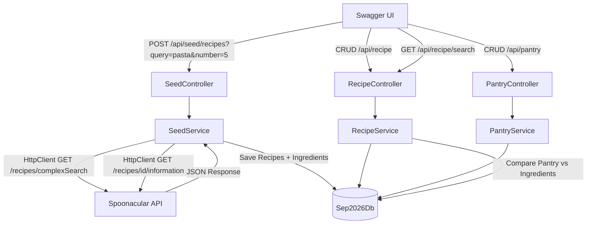

# Sep2026.RecipeAndPantryFinder — Implementation Plan

## Problem Statement
Spoonacular API မှ Recipe data များကို တစ်ကြိမ် fetch ပြုလုပ်၍ ကိုယ်တိုင်၏ SQL Server DB ထဲသို့ သိမ်းဆည်းမည်။ ထို့နောက် DB ထဲရှိ data များဖြင့် CRUD operations နှင့် Pantry-based Recipe Search ပြုလုပ်နိုင်သည့် ASP.NET Core Web API တည်ဆောက်မည်။

---

## Requirements (Final)

| # | Requirement |
|---|---|
| R1 | `Sep2026.WebApi` format (net8.0, Swagger, Controller-based, Service Layer) |
| R2 | `Sep2026.Database` ပုံစံတူ EF Core + SQL Server |
| R3 | **Seeder** — Spoonacular မှ Recipes + Ingredients ကို DB သို့ တစ်ကြိမ် migrate ပြုလုပ်မည် |
| R4 | Recipe CRUD — Create, Read, Update, Delete |
| R5 | PantryItem CRUD — manual ထည့်သွင်းမည် |
| R6 | Search — Pantry ပစ္စည်းများဖြင့် ချက်နိုင်သော Recipes ရှာဖွေနိုင်မည် |
| R7 | `Sep2026.slnx` တွင် project ထည့်သွင်းမည် |

---

## Database Design

```
┌──────────────────────────────┐
│           Recipes            │
├──────────────────────────────┤
│ RecipeId        INT  PK      │
│ Title           NVARCHAR(200)│
│ Instructions    NVARCHAR(MAX)│
│ ReadyInMinutes  INT          │
│ Servings        INT          │
└──────────┬───────────────────┘
           │ 1 to many
┌──────────▼───────────────────┐     ┌──────────────────────────────┐
│      RecipeIngredients       │     │          PantryItems         │
├──────────────────────────────┤     ├──────────────────────────────┤
│ Id              INT  PK      │     │ PantryItemId   INT  PK       │
│ RecipeId        INT  FK      │     │ ItemName  NVARCHAR(100)      │
│ IngredientName  NVARCHAR(100)│     │ Quantity  DECIMAL(10,2)      │
│ Amount          DECIMAL(10,2)│     │ Unit      NVARCHAR(50)       │
│ Unit            NVARCHAR(50) │     └──────────────────────────────┘
└──────────────────────────────┘
```

**Relationships:**
- `Recipes` (1) ──── (many) `RecipeIngredients`
- `PantryItems` — standalone (user's stock)

---

## Project Structure

```
Sep2026.RecipeAndPantryFinder/
├── Controllers/
│   ├── RecipeController.cs
│   ├── PantryController.cs
│   └── SeedController.cs
├── Models/
│   ├── Request/
│   │   ├── RecipeCreateRequestModel.cs
│   │   ├── RecipeUpdateRequestModel.cs
│   │   ├── IngredientRequestModel.cs
│   │   ├── PantryItemCreateRequestModel.cs
│   │   └── PantryItemUpdateRequestModel.cs
│   └── Response/
│       ├── RecipeResponseModel.cs
│       ├── RecipeDetailResponseModel.cs
│       ├── RecipeSearchResponseModel.cs
│       └── PantryItemResponseModel.cs
├── Services/
│   ├── IRecipeService.cs
│   ├── RecipeService.cs
│   ├── IPantryService.cs
│   ├── PantryService.cs
│   ├── ISeedService.cs
│   └── SeedService.cs
├── appsettings.json
├── Program.cs
└── Sep2026.RecipeAndPantryFinder.csproj
```

---

## Architecture Flow



---

## Pantry vs Ingredients — Concept

| | RecipeIngredients | PantryItems |
|---|---|---|
| **ကိုယ်စားပြုသည်** | Recipe ချက်ရန် **လိုအပ်သော** ပစ္စည်းများ | အိမ်တွင် **လက်ရှိရှိနေသော** ပစ္စည်းများ |
| **ဆက်နွှယ်မှု** | Recipe နှင့် FK ဖြင့် တွဲနေသည် | သီးသန့် ရပ်တည်သည် |
| **ရည်ရွယ်ချက်** | "ဤ Recipe ကို ချက်ရန် ဘာတွေ လိုမည်" | "ငါ့အိမ်တွင် အခု ဘာတွေ ရှိသည်" |

**Search Logic:**
```
PantryItems (ရှိသည်)        RecipeIngredients (လိုသည်)
─────────────────────       ──────────────────────────
✅ ကြက်ဥ          ←match→   ကြက်ဥ        (Fried Rice)
✅ ကြက်သွန်နီ     ←match→   ကြက်သွန်နီ   (Fried Rice)
❌ မရှိ                      ဆန်           (Fried Rice) ← Missing
```

---

## API Endpoints

### SeedController
| Method | Endpoint | Description |
|--------|----------|-------------|
| POST | `/api/seed/recipes?query=pasta&number=5` | Spoonacular မှ Recipes + Ingredients ကို DB သို့ seed ပြုလုပ်မည် |

### RecipeController
| Method | Endpoint | Description |
|--------|----------|-------------|
| GET | `/api/recipe` | Recipes အားလုံး list |
| GET | `/api/recipe/{id}` | Recipe detail + Ingredients |
| GET | `/api/recipe/search` | Pantry ဖြင့် match ရှာဖွေ |
| POST | `/api/recipe` | Recipe အသစ် ဖန်တီး |
| PUT | `/api/recipe/{id}` | Recipe ပြင်ဆင် |
| DELETE | `/api/recipe/{id}` | Recipe ဖျက် |

### PantryController
| Method | Endpoint | Description |
|--------|----------|-------------|
| GET | `/api/pantry` | PantryItems အားလုံး |
| GET | `/api/pantry/{id}` | PantryItem တစ်ခုချင်း |
| POST | `/api/pantry` | PantryItem အသစ် ထည့်သွင်း |
| PUT | `/api/pantry/{id}` | PantryItem ပြင်ဆင် |
| DELETE | `/api/pantry/{id}` | PantryItem ဖျက် |

---

## Task Breakdown

### Task 1: Project Scaffold + Solution Registration
- **Objective:** `Sep2026.RecipeAndPantryFinder` ASP.NET Core Web API project ဖန်တီးပြီး solution တွင် ထည့်သွင်းမည်
- **Implementation:**
  - `dotnet new webapi -n Sep2026.RecipeAndPantryFinder` ဖြင့် net8.0 project ဖန်တီး
  - `Swashbuckle.AspNetCore 6.6.2` package ထည့်သွင်း
  - `Sep2026.Database` project reference ထည့်သွင်း
  - `Sep2026.slnx` တွင် project path ထည့်သွင်း
  - Default `WeatherForecast` files ဖယ်ရှားသည်
  - `Program.cs` ကို Sep2026.WebApi ပုံစံတူ ရေးသား (Controllers, Swagger, HttpsRedirection)
  - `appsettings.json` တွင် Spoonacular BaseUrl + ApiKey ထည့်သွင်း
- **Demo:** Project build အောင်မြင်ပြီး Swagger UI `https://localhost:{port}/swagger` တွင် ပွင့်သည်

---

### Task 2: Database Tables တည်ဆောက်ခြင်း
- **Objective:** `Sep2026.Database` ထဲတွင် Recipe, RecipeIngredient, PantryItem entities နှင့် AppDbContext DbSets ထည့်သွင်းပြီး migration run ပြုလုပ်မည်
- **Implementation:**
  - `Sep2026.Database/Models/Recipe.cs` — RecipeId, Title, Instructions, ReadyInMinutes, Servings, `ICollection<RecipeIngredient>` navigation
  - `Sep2026.Database/Models/RecipeIngredient.cs` — Id, RecipeId (FK), IngredientName, Amount, Unit, `Recipe` navigation
  - `Sep2026.Database/Models/PantryItem.cs` — PantryItemId, ItemName, Quantity, Unit
  - `AppDbContext.cs` တွင် DbSets သုံးခု ထည့်သည်
  - `OnModelCreating` တွင် FK, column types, max lengths သတ်မှတ်သည်
  - `Add-Migration AddRecipeAndPantryTables` → `Update-Database` run ပြုလုပ်သည်
- **Demo:** SQL Server `Sep2026Db` တွင် `Recipes`, `RecipeIngredients`, `PantryItems` tables သုံးခု ပေါ်သည်

---

### Task 3: Spoonacular Seeder (SeedController + SeedService)
- **Objective:** `POST /api/seed/recipes` endpoint မှ Spoonacular API ကို call ပြုလုပ်ပြီး Recipes + Ingredients ကို DB သို့ သိမ်းဆည်းမည်
- **Implementation:**
  - `ISeedService.cs` — `Task<string> SeedRecipesAsync(string query, int number)` method contract
  - `SeedService.cs`:
    - `appsettings.json` မှ ApiKey + BaseUrl ဖတ်သည်
    - Spoonacular `/recipes/complexSearch?query=...&number=...&apiKey=...` ခေါ်ပြီး Recipe ID list ရယူသည်
    - Recipe ID တစ်ခုချင်းစီအတွက် `/recipes/{id}/information` ခေါ်ပြီး Ingredients + Instructions ရယူသည်
    - DB တွင် ထပ်နေသော Recipe (title တူ) ကို skip ပြုလုပ်သည်
    - `Recipes` + `RecipeIngredients` tables တွင် သိမ်းဆည်းသည်
  - `SeedController.cs`:
    - `POST /api/seed/recipes?query=pasta&number=5`
    - `query` မထည့်ပါက default `"chicken"` သုံးသည်
    - `number` မထည့်ပါက default `10` သုံးသည်
    - Spoonacular error ဖြစ်ပါက `BadRequest(errorMessage)` ပြန်ပေးမည်
  - `Program.cs` တွင် `HttpClient`, `ISeedService` → `SeedService` register ပြုလုပ်မည်
- **Spoonacular API Key:** `30eaa87b4a9e4546b129e318144c0623`
- **Demo:** Swagger မှ `POST /api/seed/recipes?query=fried rice&number=5` run ပြီးနောက် SQL Server တွင် Recipes ၅ ခု + ၎င်းတို့၏ Ingredients များ ပေါ်သည်

---

### Task 4: PantryItem CRUD (PantryController + PantryService)
- **Objective:** PantryItem ၏ Create, Read, Update, Delete အပြည့်အစုံ အလုပ်လုပ်မည်
- **Implementation:**
  - `IPantryService.cs` — CRUD method contracts
  - `PantryService.cs` — EF Core ဖြင့် CRUD
  - `PantryItemCreateRequestModel.cs` — ItemName, Quantity, Unit
  - `PantryItemUpdateRequestModel.cs` — ItemName, Quantity, Unit
  - `PantryItemResponseModel.cs` — PantryItemId, ItemName, Quantity, Unit
  - `PantryController.cs`:
    - `GET /api/pantry` — PantryItems အားလုံး
    - `GET /api/pantry/{id}` — တစ်ခုချင်း၊ မတွေ့ပါက `NotFound`
    - `POST /api/pantry` — အသစ်ထည့်သွင်း
    - `PUT /api/pantry/{id}` — update
    - `DELETE /api/pantry/{id}` — ဖျက်မည်
  - `Program.cs` တွင် `IPantryService` → `PantryService` register
- **Demo:** Swagger မှ "ကြက်ဥ — 3 လုံး", "ကြက်သွန်နီ — 2 လုံး" ထည့်သွင်း၊ ကြည့်ရှု၊ ပြင်ဆင်၊ ဖျက်နိုင်သည်

---

### Task 5: Recipe CRUD (RecipeController + RecipeService)
- **Objective:** Recipe ၏ Create, Read, Update, Delete အပြည့်အစုံ အလုပ်လုပ်မည်
- **Implementation:**
  - `IRecipeService.cs` — CRUD + Search method contracts
  - `RecipeService.cs` — EF Core ဖြင့် CRUD
  - `IngredientRequestModel.cs` — IngredientName, Amount, Unit
  - `RecipeCreateRequestModel.cs` — Title, Instructions, ReadyInMinutes, Servings, `List<IngredientRequestModel>`
  - `RecipeUpdateRequestModel.cs` — Title, Instructions, ReadyInMinutes, Servings, `List<IngredientRequestModel>`
  - `RecipeResponseModel.cs` — RecipeId, Title, ReadyInMinutes, Servings
  - `RecipeDetailResponseModel.cs` — RecipeId, Title, Instructions, ReadyInMinutes, Servings, `List<string>` Ingredients
  - `RecipeController.cs`:
    - `GET /api/recipe` — Recipes list
    - `GET /api/recipe/{id}` — Detail + Ingredients၊ မတွေ့ပါက `NotFound`
    - `POST /api/recipe` — Recipe + Ingredients တစ်ပြိုင်တည်း သိမ်း
    - `PUT /api/recipe/{id}` — Recipe update (Ingredients replace)
    - `DELETE /api/recipe/{id}` — Recipe + Ingredients cascade ဖျက်
  - `Program.cs` တွင် `IRecipeService` → `RecipeService` register
- **Demo:** Swagger မှ Recipe ကိုယ်တိုင် ဖန်တီး၊ Seeder မှ ရလာသော Recipe ကို ပြင်ဆင်၊ ဖျက်နိုင်သည်

---

### Task 6: Pantry-based Recipe Search
- **Objective:** Pantry ထဲရှိ ပစ္စည်းများနှင့် Recipe Ingredients ကို match စစ်ဆေး၍ ချက်နိုင်သော Recipes ရှာဖွေမည်
- **Implementation:**
  - `RecipeSearchResponseModel.cs` — RecipeId, Title, MatchedIngredientCount, TotalIngredientCount, `List<string>` MissingIngredients
  - `RecipeService.SearchRecipesByPantryAsync()`:
    - DB မှ PantryItems အားလုံး ဖတ်သည်
    - Recipes + RecipeIngredients (Include) ဖတ်သည်
    - PantryItem names နှင့် IngredientName ကို **case-insensitive** match စစ်ဆေးသည်
    - MatchedCount နှင့် MissingIngredients တွက်ချက်သည်
    - MatchedCount များသော Recipe ကို အရင်ဆုံး ပြသမည် (order by matched desc)
  - `RecipeController` တွင် `GET /api/recipe/search` endpoint ထည့်သွင်းမည်
  - Pantry empty ဖြစ်ပါက `BadRequest("Pantry is empty. Please add items to your pantry first.")`
- **Demo:** Task 3 Seeder မှ ရလာသော Recipes + Task 4 မှ ထည့်သွင်းထားသော Pantry Items ဖြင့် Search ခေါ်ပါက matched recipes list + missing ingredients ပြသသည်

---

## Spoonacular API Reference

| Endpoint | Usage |
|----------|-------|
| `GET /recipes/complexSearch?query=pasta&number=5&apiKey=...` | Recipe ID list ရယူမည် |
| `GET /recipes/{id}/information?apiKey=...` | Recipe detail (ingredients, instructions) ရယူမည် |

**API Key:** `30eaa87b4a9e4546b129e318144c0623`  
**Base URL:** `https://api.spoonacular.com`

---

## Notes
- `Sep2026.Database` project ကို reference ယူ၍ EF Core AppDbContext ကို reuse ပြုလုပ်မည်
- Seeder endpoint သည် development/setup အတွက်သာ သုံးမည် (production တွင် disable ပြုလုပ်နိုင်သည်)
- PantryItems ကို Spoonacular တွင် concept မရှိသောကြောင့် manual CRUD ဖြင့်သာ ထည့်သွင်းမည်
- Recipe title duplicate ဖြစ်ပါက Seeder မှ skip ပြုလုပ်မည်
